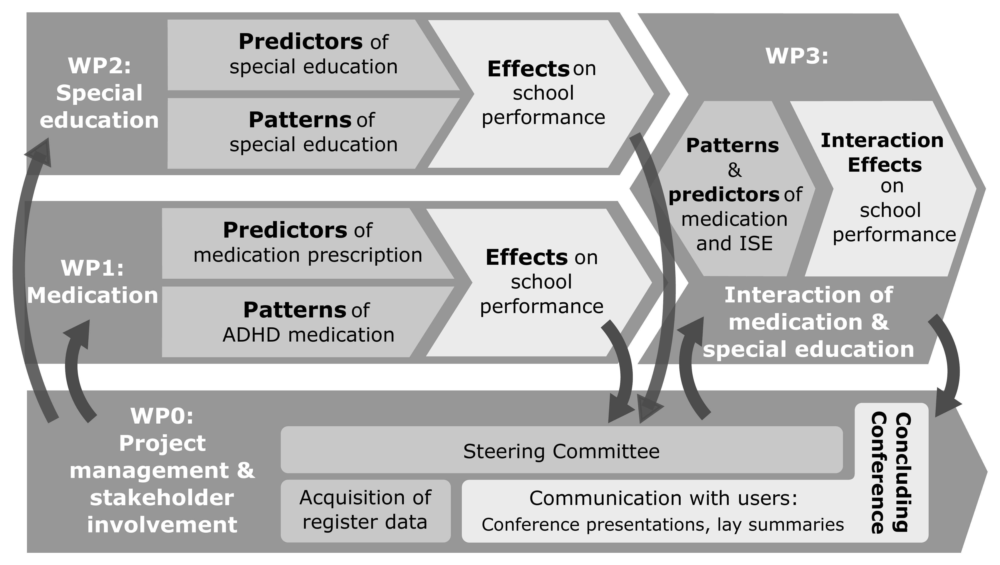

Attention-deficit/hyperactivity disorder (ADHD) is a central thematic focus across my applied and methodological research. Combining population-wide Norwegian health and education registries, the [Norwegian Mother, Father and Child Cohort Study (MoBa)](https://www.fhi.no/en/studies/moba/), clinical cohorts, and experimental studies, my colleagues and I study ADHD from early childhood into adulthood.

A major current focus is estimating the long-term effects of stimulant medication and special educational assistance on school performance and psycho-social outcomes of children with ADHD using target trial emulation and Bayesian structural modelling (see the [project overview](nfrsea.qmd)). Complementing this work, we investigate early screening, developmental trajectories, comorbid anxiety and depression, geographic and family-level variation in diagnosis and treatment, and prenatal environmental and nutritional risk factors.

In earlier experimental and neuroimaging work, we also used computational models of reinforcement learning and decision making to examine cognitive and neural mechanisms in adults with ADHD and how stimulant medication alters these processes.

## Research projects

::: {#category-projects}
:::

## Publications

::: {#category-publications}
:::
