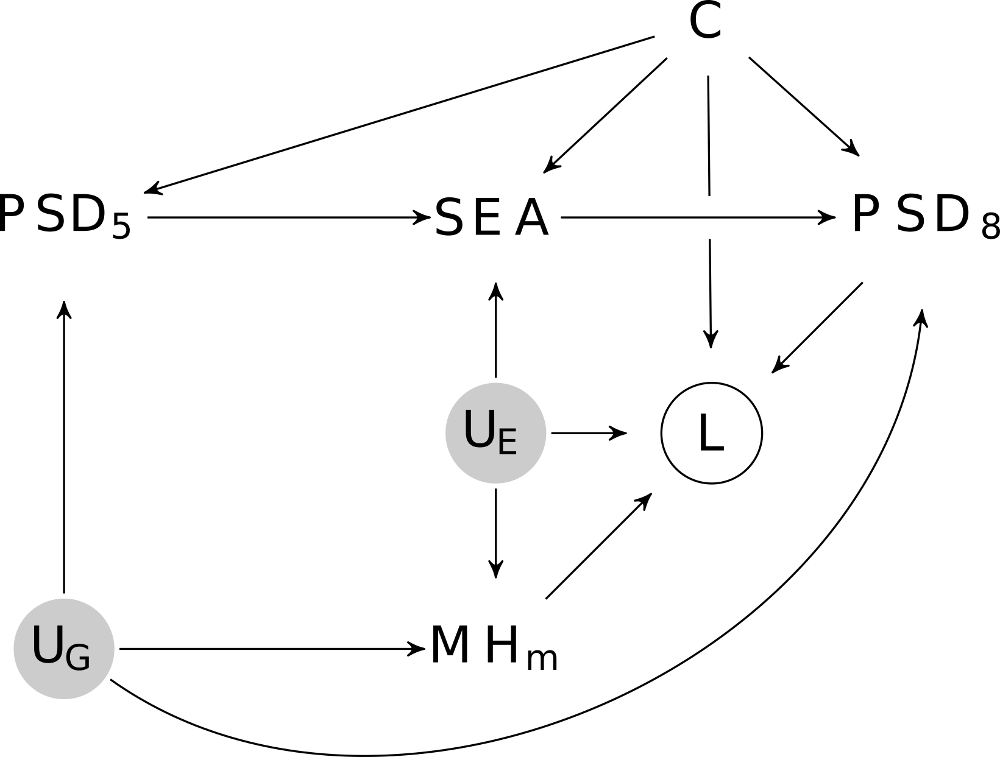

Randomised controlled trials (RCTs) are due to their internal validity considered as the gold standard for causal inference. But RCTs are not always feasible or ethical, for instance if one is interested in long-term effects of treatments. More generally, every investigation of causal effects trades off internal and external validity. Hence, observational studies of causal effect, which tend to have higher external validity, have their place independent of the practical or ethical challenges RCTs can pose.

This research line began with a grant from the Norwegian Research Council and now spans both applied register studies and methodological work in causal inference. The thematic focus of this research is on the effect of medication and special education on educational and other outcomes of children with ADHD.

One important challenge when estimating treatment effects from observational data is that of non-random selection into treatment or treatment by indication. To deal with this and other biases, one can use directed acyclic graphs (DAGs) to represent the (assumed) causal structure that generates the data we observe and to determine the best ways to deal with potential biases. Depending on the causal structure, adjustment, multilevel regression and post stratification, weighting or a combination of these approaches can be useful. I am also planning to explore methods often used in econometrics, like Difference in Differences or regression discontinuity, though it is uncertain that there exist data in Norway that would allow to estimate average treatment effects.

The goal of this research is to provide estimates of causal effects, even if we know that these will always be imperfect. Our approach is to reduce this imperfection as much as we can, and to be transparent about the remaining uncertainties like unobserved confounders when we describe results.

## Research projects

::: {#category-projects}
:::

## Publications

::: {#category-publications}
:::
