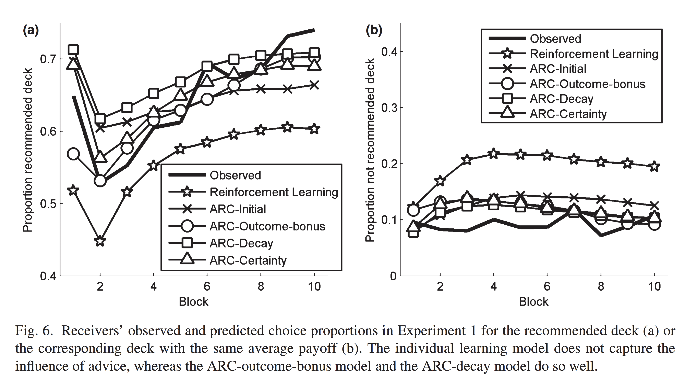
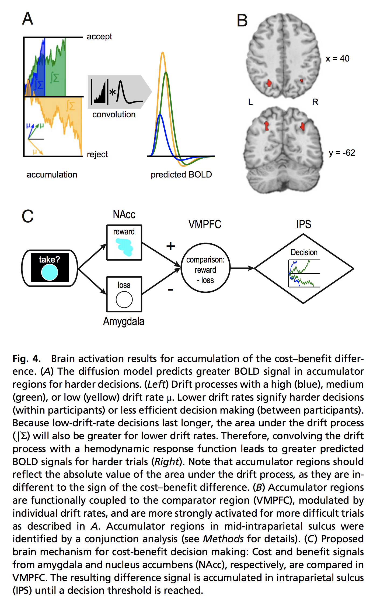

My research career started in the [Centre for Adaptive Behavior and Cognition](https://www.mpib-berlin.mpg.de/research/concluded-areas/center-for-adaptive-behavior-and-cognition) at the [Max Planck Institute for Human Development](https://www.mpib-berlin.mpg.de/en) in Berlin. This research line, in which I am currently not active, used experiments and mathematical modeling to understand decision making in a social context. In one paper we investigated, using mathematical modeling of choices in public goods games, if cooperation in groups is better explained by simple [reinforcement learning, or by reciprocity](https://psycnet.apa.org/record/2008-07158-002). In hindsight it is not surprising that reciprocity explained behavior better. At the time a number of researchers proposed reinforcement learning as models of cooperation, because they naturally explain how cooperation unravels in social dilemmas like the public goods game or the prisoners dilemma.

Other papers in this area examined how basic reinforcement learning models can be modified to account for [advice taking](https://pubmed.ncbi.nlm.nih.gov/21585468/) or for [pattern learning](https://psycnet.apa.org/record/2009-07078-004). In this area fall also some papers that have mostly an interest in decision making in common, such as the one where we learned that [economists did not use much rational analysis](https://www.nowpublishers.com/article/Details/RBE-0034) when deciding about taking a PSA test and that [some ignorance can be better than imperfect knowledge](https://www.sciencedirect.com/science/article/abs/pii/S0001691806000801) when predicting outcomes of sports matches.

Building on this foundation, I used and sometimes still use mathematical modelling of decision making and learning, functional magnetic resonance imaging (fMRI), and EEG to understand human operant learning and decision making, and how decision processes differ in adults with ADHD.

In one paper, colleagues and I used a sequential sampling model of decision making and fMRI to describe how [costs and benefits are represented in the brain](https://pubmed.ncbi.nlm.nih.gov/21118983/) during decision making. In a related paper we looked for [representations of probabilistic evidence](https://pubmed.ncbi.nlm.nih.gov/20439711/) during reward based decision making.

I have also done [some](https://pubmed.ncbi.nlm.nih.gov/20510376/) [work](https://pubmed.ncbi.nlm.nih.gov/19822738/) on reinforcement learning in general, and how it is influenced by social learning, leading to the proposal that [following advice can in itself be rewarding](https://journals.plos.org/plosbiology/article?id=10.1371/journal.pbio.1001089). Some of this work has clear markers of a past time, like the [small-sample target-gene study](https://pubmed.ncbi.nlm.nih.gov/19822738/). This was exciting work at the time, but I would approach this research differently today.

More recently, I have used quantitative models of decision making to understand decision making in ADHD. We have published a [meta analysis](https://pubmed.ncbi.nlm.nih.gov/25477020/) and a [theoretical review](https://pubmed.ncbi.nlm.nih.gov/27608958/) which describes how we can use quantitative models of reinforcement learning and decision making to better understand the development and symptoms of Attention Deficit Hyperactivity Disorder. In an empirical paper, we used the [drift diffusion model of decision making as a choice module in a reinforcement learning model](https://pubmed.ncbi.nlm.nih.gov/27966103/) to describe the effect of ADHD medication on decision making and operant learning.

## Research projects

::: {#category-projects}
:::

## Publications

::: {#category-publications}
:::
