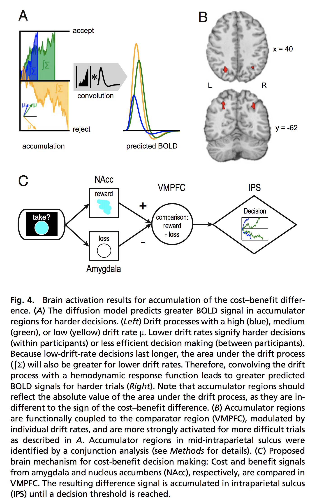

In this research line I used and sometimes still use mathematical modelling of decision making and learning, functional magnetic resonance imaging (fMRI), and EEG to understand human operant learning and decision making. We also investigate how learning and decision making processes are different in adults with ADHD.

In one paper, colleagues and I used a sequential sampling model of decision making and fMRI to describe how [costs and benefits are represented in the brain](https://pubmed.ncbi.nlm.nih.gov/21118983/) during decision making. In a related paper we looked for [representations of probabilistic evidence](https://pubmed.ncbi.nlm.nih.gov/20439711/) during reward based decision making.

I have also done [some](https://pubmed.ncbi.nlm.nih.gov/20510376/) [work](https://pubmed.ncbi.nlm.nih.gov/19822738/) on reinforcement learning in general, and how it is influenced by social learning, leading to the proposal that [following advice can in itself be rewarding](https://journals.plos.org/plosbiology/article?id=10.1371/journal.pbio.1001089). Some of this work has clear markers of a past time, like the [small-sample target-gene study](https://pubmed.ncbi.nlm.nih.gov/19822738/). This was exciting work at the time, but I would approach this research differently today.

More recently, I have used quantitative models of decision making to understand decision making in ADHD. We have published a [meta analysis](https://pubmed.ncbi.nlm.nih.gov/25477020/) and a [theoretical review](https://pubmed.ncbi.nlm.nih.gov/27608958/) which describes how we can use quantitative models of reinforcement learning and decision making to better understand the development and symptoms of Attention Deficit Hyperactivity Disorder. In an empirical paper, we used the [drift diffusion model of decision making as a choice module in a reinforcement learning model](https://pubmed.ncbi.nlm.nih.gov/27966103/) to described the effect of ADHD medication on decision making and operant learning.
