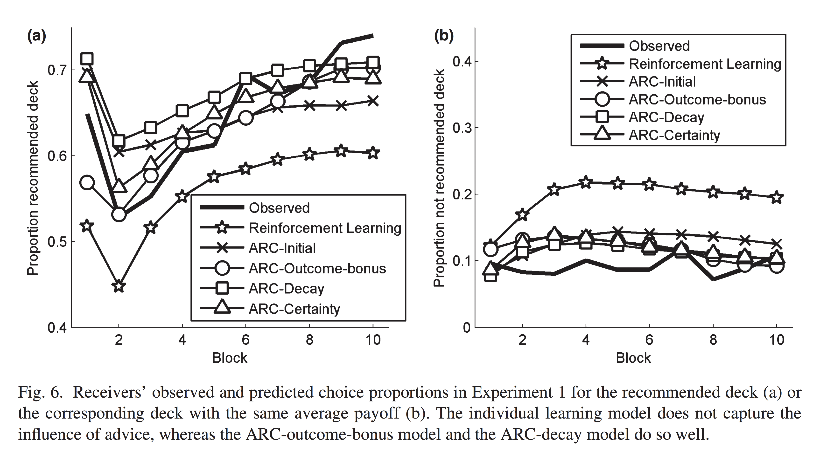

My research career started in the [Centre for Adaptive Behavior and Cognition](https://www.mpib-berlin.mpg.de/research/concluded-areas/center-for-adaptive-behavior-and-cognition) at the [Max Planck Institute for Human Development](https://www.mpib-berlin.mpg.de/en) in Berlin. This research line, in which I am currently not active, used experiments and mathematical modeling to understand decision making in a social context. In one paper we investigated, using mathematical modeling of choices in public goods games, if cooperation in groups is better explained by simple [reinforcement learning, or by reciprocity](https://psycnet.apa.org/record/2008-07158-002). In hindsight it is not surprising that reciprocity explained behavior better. At the time a number of researchers proposed reinforcement learning as models of cooperation, because they naturally explain how cooperation unravels in social dilemmas like the public goods game or the prisoners dilemma.

Other papers in this area examined how basic reinforcement learning models can be modified to account for [advice taking](https://pubmed.ncbi.nlm.nih.gov/21585468/) or for [pattern learning](https://psycnet.apa.org/record/2009-07078-004).

In this area fall also some papers that have mostly an interest in decision making in common, such as the one where we learned that [economists did not use much rational analysis](https://www.nowpublishers.com/article/Details/RBE-0034) when deciding about taking a PSA test and that [some ignorance can be better than imperfect knowledge](https://www.sciencedirect.com/science/article/abs/pii/S0001691806000801) when predicting outcomes of sports matches.
