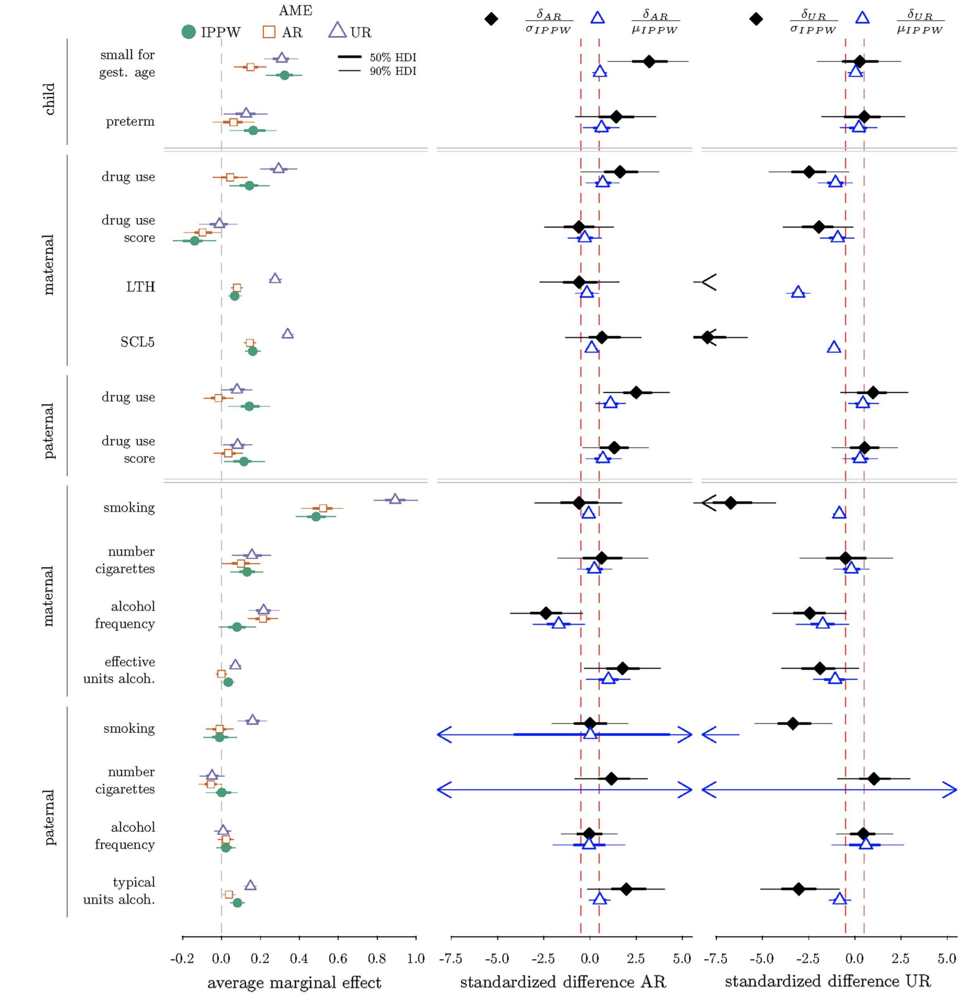

In this research line I use epidemiological approaches to learn more about risk factors for ADHD.

One paper in this area examines [how self selection into a study and loss to follow up can bias associations between exposures and outcomes](https://pubmed.ncbi.nlm.nih.gov/31451995/), and how one can best reduce this bias. Elaborating on a [seminal paper by Hernan and colleagues](https://pubmed.ncbi.nlm.nih.gov/15308962/) we point out that one cannot determine if large studies such as for example [MoBa](https://www.fhi.no/en/studies/moba/), [ALSPAC](https://www.bristol.ac.uk/alspac/) or the [UK Biobank](https://www.ukbiobank.ac.uk/) are generally "representative". Instead the relationship between specific variables of interest in a study and variables that predict (continued) participation determine if bias is likely and how it should be accounted for. Importantly: When mental health related outcomes like ADHD, depression, etc. are involved, simply adjusting for participation predictors will often increase and not decrease bias. In comparison, inverse probability of participation weights will reduce bias. The reason is that participation predictors are often colliders between (mental health) outcomes and exposures, and conditioning on colliders introduces bias, but weighting does not.

In other research colleagues and I investigate associations between maternal characteristics, often assessed in pregnancy, and developmental outcomes including ADHD. Differently than some research in this field, we use Bayesian hierarchical[^1] regression models to estimate associations, which allows us to deal effectively with the multiple comparison problem, and we focus on effect sizes as opposed to statistical significance (using [MoBa](https://www.fhi.no/en/studies/moba/), our sample size is often in the tens of thousands). So far, our findings indicate that in rich industrialized countries the association between maternal nutrition or exposure to toxicants and child developmental outcomes are [so small that they are unlikely to be practically significant](https://pubmed.ncbi.nlm.nih.gov/31375821/).

[^1]: I think more researchers could be aware that by [Stein's Paradox](https://en.wikipedia.org/wiki/Stein%27s_example) estimates for sub-groups from a hierarchical regression expected to be more accurate than estimates from separate analyses of sub-groups. See also Sander Greenland's article on [Principles of multilevel modelling](https://academic.oup.com/ije/article/29/1/158/666823).
