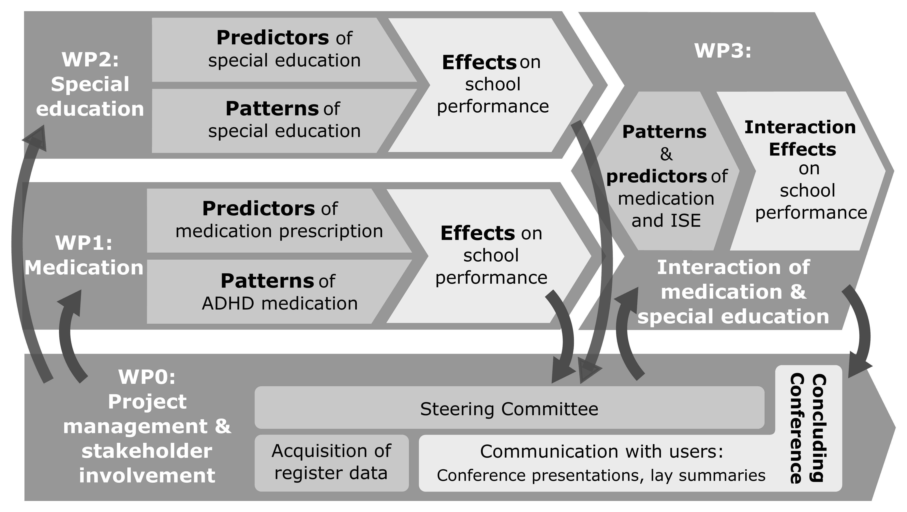

In this project we are trying to answer an important but hard question: Do ADHD medication and special education improve school performance? with observational data. Estimating causal effects from observational data is hard, some would say rarely possible at all. To still make progress, this project uses large data sets from national registries and approaches including structural models and Bayesian estimation of structural models.

Here is my related research about [selection bias](../files/Biele_2019.pdf) and [estimation of causal effects with observational data](../files/sps358_8grp.pdf)[^1].

## Some background

Most children with ADHD have minor or severe reading and writing problems already in the third grade. A substantial proportion of children and youth receive special educational assistance and/or ADHD medication. This begs the question: Do medication and special educational assistance improve school performance? This question is important, because the few papers that looked at long-term effects of medication find only very small effects, and we know even less about the long-term effects of special educational assistance.

## Some methods

This project uses data from Norwegian national registries and the Norwegian Mother, Father and Child Cohort Study (MoBa) to estimate the effects of medication and special education on school performance of children with ADHD or other mental health or developmental problems.

Using observational data to estimate treatment effects is difficult (some would say impossible), because individuals are not randomized into treatment conditions. We are still doing this project for two reasons. First, we are interested in effects of longer-term treatments, but conducting randomized controlled trials (RCTs) is considered unethical if one wants to estimate long-term effects of treatments that one assumes should be beneficial. Secondly, well designed placebo controlled randomized trials have the strongest internal validity--if we see outcome differences between treatment conditions those are due to the treatment, but they still can have a sub-optimal external validity, i.e. we remain uncertain if the treatment effect generalizes to treatment that is not implemented in the context of an RCT. Reasons for a limited external validity include less formalized implementation of treatments outside RCTs or non-random selection of participants into the RCTs. Therefore, carefully implemented observational studies can be a useful complement to RCTs.

Our approach to a careful implementation of an observational study is to formulate and check a structural model that describes the assumed data-generating process, and to use Bayesian estimation of hierarchical models to obtain estimates of causal effects. [Here](../files/sps358_8grp.pdf) is an article in which we implemented such an approach.

![**Directed acyclic graphs (DAGs) of design and causal assumptions** (a) School performance at time *t2* (SP~*t2*~, results of national tests in grades 8 and 9) depends on medication (MED), individual special education (ISE), and on confounders like earlier school performance (SP~*t1*~, national tests grade 5), parental education (EDU), and comorbid disorders (COM). Additional potential confounders like gender or parental mental health are omitted here for clarity. (b) Bias from observed confounders (here SP~*t1*~, which predicts exposure MED and outcome SP~t2~) can be controlled by adjusting for them. (c) When SP~*t1*~ is a collider between U~PA~ (*unobserved* parental attention) and U~SC~ (*unobserved* school quality), adjustment for SP~*t1*~ leads to conditioning on a collider and cannot correct bias. Instead, inverse probability of treatment weights need to be used.](nfrsea/SA_DAG.png)

## Data

We are starting with a base population of around 600,000 children in Norway that were born between 2000 and 2100. The study population consists of children with ADHD or other mental health or developmental problems (up to maybe 60,000), and these children's parents and siblings. Parents and siblings are an important part of children's environment, which has an influence on school performance generally, and which can also influence how effective treatments are implemented. Special education data is only available from MoBa, so that sample sizes will be smaller for these analyses.

  Age                          0           5          6,7          8       10 (*t1*)     11-14     15 (*t1*)
  ----------------------- ----------- ----------- ----------- ----------- ----------- ----------- -----------
  Diagnoses                   NPR         NPR         NPR         NPR         NPR         NPR         NPR
  ADHD symptoms                          MoBa                    MoBa                             
  Therapy                  NPR, KUHR   NPR, KUHR   NPR, KUHR   NPR, KUHR   NPR, KUHR   NPR, KUHR   NPR, KUHR
  Medication                 NorPD       NorPD       NorPD       NorPD       NorPD       NorPD       NorPD
  Special education                      MoBa                    MoBa                    MoBa     
  School perform.                                                MoBa         SSB        MoBa         SSB
  Parental edu & income       SSB          S          SSB         SSB         SSB         SSB         SSB
  Parental diagnoses          NPR         NPR         NPR         NPR         NPR         NPR         NPR

NPR: Norwegian patient registry, MoBa: Norwegian Mother, Father and Child Cohort Study, KUHR: Norway Control and Payment of Health Reimbursement Database, NorPD: Norwegian prescription data base. SSB: Statistics Norwy

## Pilot analyses

To check the general feasibility of the project I did some pilot analyses with data from MoBa, NPR, and NorPD (N \~ 1,500 children with ADHD). I used a hierarchical Bayesian ordered logistic regressions to estimate the effect of special education in kindergarten or ADHD medication on reading problems in the 3rd grade. I used inverse probability of treatment weights to adjust for confounding by indication. This analysis shows that on average treatment reduces difficulties, but that also show that effect sizes vary substantially between sub-groups characterised by maternal education and child gender.

## Working packages

WP0 provides input for and guides working packages that implement the research and also organizes acquisition of registry data and communication with users. WP1-WP3 follow a similar approach: Treatment patterns and predictors are identified in a first step, based on which effects are estimated in a second step. WP1 focuses on medication and uses data from Norway and Sweden. WP2 focuses on special education. WP3 focuses on interaction effects of special education and medication.

## Collaborators

The project will be implemented in collaboration with colleagues in Norway, Sweden, and the UK.

- [Jon Michael Gran](https://www.med.uio.no/imb/english/people/aca/jonmic/) (University of Oslo)
- [Mari Vaage Wang](https://www.fhi.no/en/about/departments-and-centres/child-health-and-development/mari-vaage-wang/) (NIPH, Oslo)
- [Øystein Karlstad](https://www.fhi.no/en/about/departments-and-centres/chronic-diseases-and-ageing/oystein-karlstad/) (NIPH, Oslo)
- [Christian Wendelborg](https://samforsk.no/Sider/Ansatte/Christian-Wendelborg.aspx) (NTNU, Trondheim)
- [Henrik Larsson](https://staff.ki.se/people/henlar) (Karolinska Institiute, Stockholm)
- [Reinie Cordier](https://www.northumbria.ac.uk/about-us/our-staff/c/reinie-cordier/) (Northumbria University, Newcastle)
- Mats Fredrirksen ([Sykehuset i Vestfold](https://siv.no))
- Nina Holmen ([ADHD Norge](https://adhdnorge.no))

[^1]: This paper does not address one issue that complicates Bayesian estimation of structural models: In some circumstances, bias cannot be reduced through adjustment or multilevel regression and post stratification and one has to use weighting. The problem with weighting is that for a fully Bayesian approach, one would like to estimate weights and treatment effects in one model. However, this is due to model coupling impossible. This the begs the question how one could still propagate uncertainty about model weights into the estimation of treatment effects. As far as I know, there are currently no perfect answers to this question.
